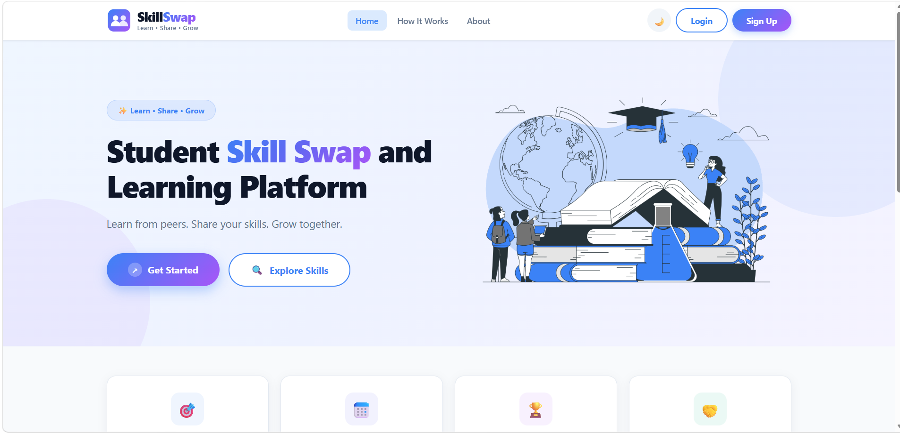
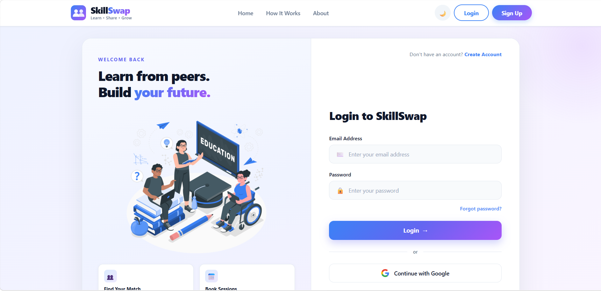
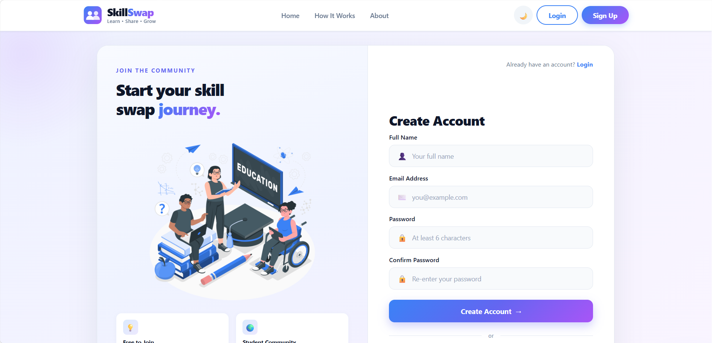
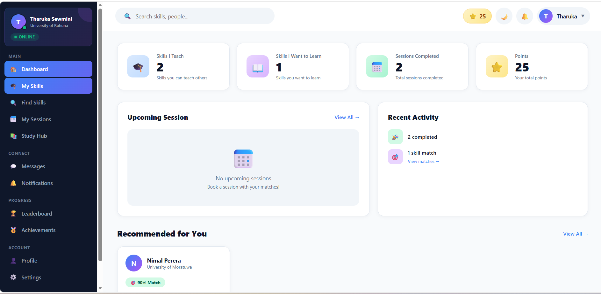
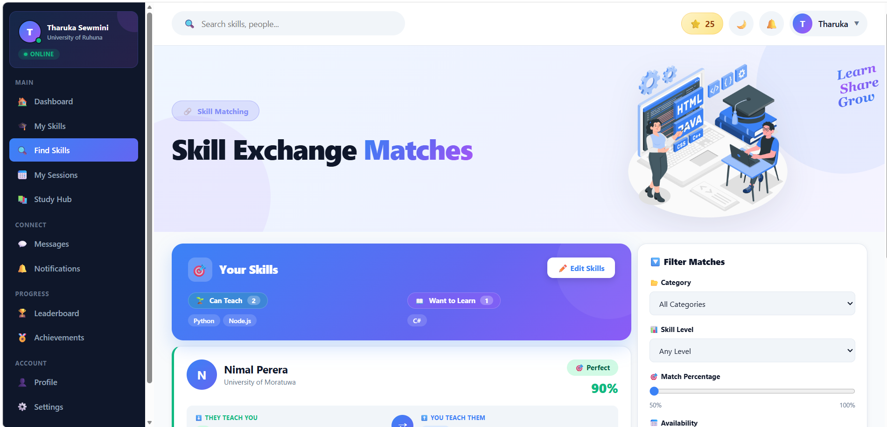
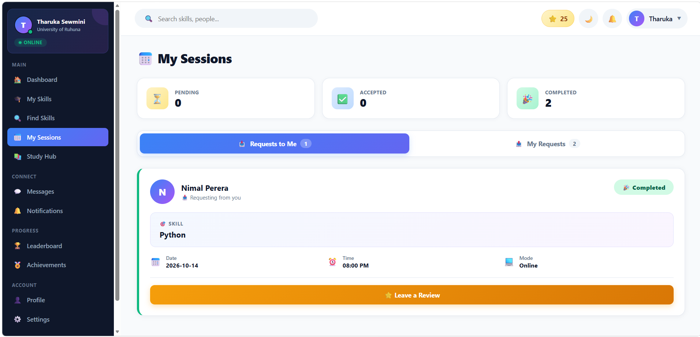
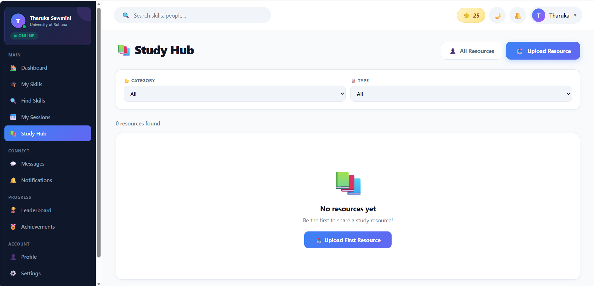
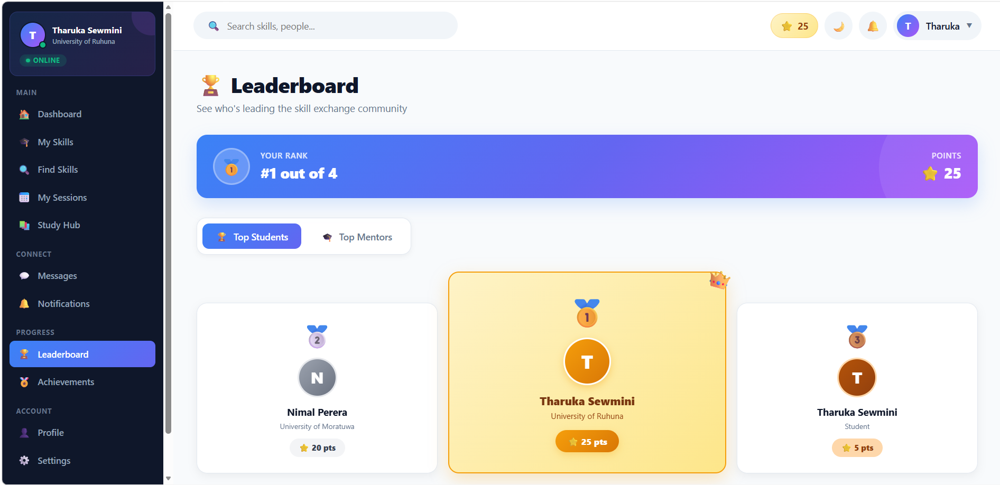
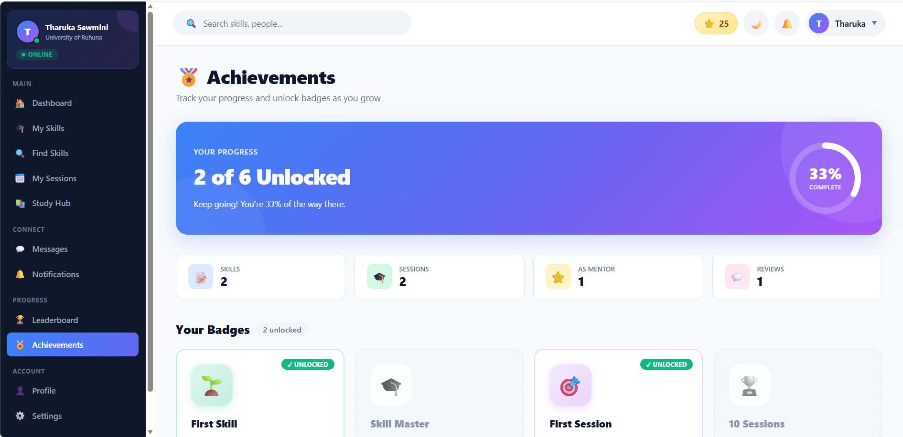
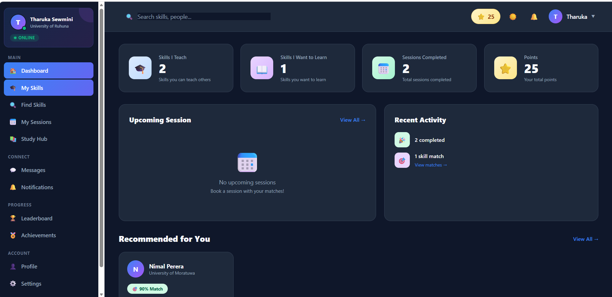

<div align="center">

# 🎓 SkillSwap

### Student Skill Exchange and Learning Platform

**Learn from peers. Share your skills. Grow together.**

[](https://www.mongodb.com/mern-stack)
[](https://reactjs.org/)
[](https://nodejs.org/)
[](https://www.mongodb.com/)
[](LICENSE)

A full-stack **MERN** web application that allows university students to exchange skills with each other — teach what you know, learn what you don't, all within a trusted student community.

**Built as part of the EC4307 - Web Application Development module.**

</div>

---

## 📖 Table of Contents

- [Overview](#-overview)
- [Core Concept](#-core-concept)
- [Features](#-features)
- [Tech Stack](#-tech-stack)
- [Architecture](#-architecture)
- [Screenshots](#-screenshots)
- [Installation](#-installation)
- [Environment Variables](#-environment-variables)
- [API Endpoints](#-api-endpoints)
- [Database Models](#-database-models)
- [Project Structure](#-project-structure)
- [Future Enhancements](#-future-enhancements)
- [Author](#-author)

---

## 🌟 Overview

**SkillSwap** is a student-powered platform designed to make learning accessible, collaborative, and free. Instead of paying for expensive courses, students can:

- 📚 **Teach** skills they already know
- 🎯 **Learn** skills they want to master
- 🤝 **Connect** with peers from their university
- 🏆 **Earn** points and achievements as they grow

The platform solves a real problem: **students want to learn new skills but can't afford paid courses, while others have valuable skills they can teach.**

---

## 🎯 Core Concept

In a real-world skill exchange setting, SkillSwap's **smart matching algorithm** finds:

- **You can teach → They want to learn**
- **They can teach → You want to learn**

This creates a **perfect two-way skill swap** — the signature feature of the platform.

```
User A                    User B
├─ Teaches: Python        ├─ Teaches: React
└─ Wants: React           └─ Wants: Python
       ↓                         ↓
       └──────── MATCH ──────────┘
              (90% Match!)
```

---

## ✨ Features

### 🔐 Authentication & User Management
- **Email/Password authentication** with bcrypt hashing
- **Google OAuth 2.0** login (one-click signup)
- **JWT-based sessions** (30-day expiry)
- **Set Password** for Google users (dual login)
- **Profile management** with university details
- **Avatar support** (initial-based)

### 🎓 Skill Management
- Add skills you can **teach** (Offer)
- Add skills you want to **learn** (Request)
- Categorize: Programming, Design, Languages, Music, Academic, Other
- Automatic **+5 points** per skill

### 🎯 Smart Matching Algorithm
- **Bidirectional matching** — teach + learn
- **Match score** calculation (0-100%)
- **Perfect match** detection (90%+)
- Filter by skill, category, percentage

### 📅 Session Booking & Management
- Book sessions with matches
- Choose **date, time, mode** (Online/Physical)
- **Status workflow:** Pending → Accepted → Completed/Rejected
- Automatic notifications on status changes
- **+10 points** on completion (both users)

### ⭐ Reviews & Ratings
- 5-star rating system
- Written reviews after completed sessions
- Average rating on profile
- **+5 bonus points** for 5-star reviews

### 🏆 Gamification System
- **Points** earned through activity
- **Leaderboard** with top 10 students
- **6 Achievements:**
  - 🌱 First Skill
  - 🎓 Skill Master (5 skills)
  - 🎯 First Session
  - 🏆 10 Sessions
  - ⭐ Top Mentor
  - 🤝 Community Helper

### 💬 Real-time Messaging
- **Socket.IO** for instant delivery
- **Typing indicators**
- **Online/offline status**
- Unread message counters
- Conversation list with previews

### 🔔 Notifications
- Session requests, accepts, rejects, completions
- New reviews
- New messages
- Real-time badge updates

### 📚 Study Hub (Community Resources)
- **Upload** study materials (PDF, DOC, PPT, XLS, ZIP, images — 20MB max)
- **Browse** by category, type
- **Download** with count tracking
- **Filter** by "My Resources"
- Free community-shared learning

### 🎨 User Experience
- **Dark/Light theme** with instant toggle
- **Responsive design** (mobile, tablet, desktop)
- **Smooth animations** and transitions
- **Modern UI** with gradient accents
- **Search functionality**

---

## 🛠 Tech Stack

### Frontend

| Technology | Version | Purpose |
|------------|---------|---------|
| **React** | 19.2.8 | UI library |
| **React Router DOM** | 7.18.4 | Client-side routing |
| **Vite** | 8.3.0 | Build tool + dev server |
| **Axios** | 1.20.0 | HTTP client |
| **Socket.IO Client** | 4.8.4 | Real-time communication |
| **@react-oauth/google** | Latest | Google OAuth |

### Backend

| Technology | Version | Purpose |
|------------|---------|---------|
| **Node.js** | 24+ | Runtime |
| **Express.js** | 5.2.1 | Web framework |
| **MongoDB** | 9.10.2 | Database |
| **Mongoose** | 9.10.2 | ODM |
| **JWT** | 9.0.3 | Authentication |
| **bcryptjs** | 3.0.3 | Password hashing |
| **Socket.IO** | 4.8.4 | WebSocket server |
| **Multer** | Latest | File uploads |
| **google-auth-library** | Latest | Google OAuth verification |
| **dotenv** | 18.0.3 | Environment variables |
| **cors** | 2.8.6 | CORS handling |

---

## 🏗 Architecture

```
┌─────────────────────────────────────────────────────────────┐
│                        CLIENT (React)                        │
│  ┌────────────┐  ┌────────────┐  ┌────────────┐              │
│  │   Pages    │  │ Components │  │  Context   │              │
│  │ (15+ views)│  │ (10+ comps)│  │(Auth/Sock) │              │
│  └────────────┘  └────────────┘  └────────────┘              │
└────────────┬─────────────────────────┬──────────────────────┘
             │ HTTP (Axios)            │ WebSocket (Socket.IO)
             ▼                         ▼
┌─────────────────────────────────────────────────────────────┐
│                     SERVER (Express.js)                      │
│  ┌─────────────────────────────────────────────────────┐     │
│  │  Routes → Middleware (JWT) → Controllers            │     │
│  └─────────────────────────────────────────────────────┘     │
│  ┌─────────────────────────────────────────────────────┐     │
│  │  Socket.IO Server (real-time messaging)             │     │
│  └─────────────────────────────────────────────────────┘     │
└────────────┬────────────────────────────────────────────────┘
             │ Mongoose ODM
             ▼
┌─────────────────────────────────────────────────────────────┐
│                    DATABASE (MongoDB)                        │
│  Users · Skills · Sessions · Reviews · Messages ·           │
│  Notifications · Resources                                   │
└─────────────────────────────────────────────────────────────┘
```

---

## 📸 Screenshots

### 🏠 Home Page


### 🔐 Login & Register



### 📊 Dashboard


### 🎯 Matches


### 📅 Sessions


### 📚 Study Hub


### 🏆 Leaderboard


### 🏅 Achievements


### 🌙 Dark Mode


---

## 🚀 Installation

### Prerequisites

- **Node.js** v20+ ([Download](https://nodejs.org/))
- **MongoDB** ([Local](https://www.mongodb.com/try/download/community) or [Atlas](https://www.mongodb.com/atlas))
- **Git** ([Download](https://git-scm.com/))

### Clone Repository

```bash
git clone https://github.com/tharukasewmini1230-creator/SkillConnect.git
cd SkillConnect
```

### Backend Setup

```bash
cd backend
npm install

# Create .env file (see Environment Variables section)

npm start
```

Backend will run on **`http://localhost:5000`**

### Frontend Setup

```bash
cd frontend
npm install

npm run dev
```

Frontend will run on **`http://localhost:5173`**

### Google OAuth Setup

1. Go to [Google Cloud Console](https://console.cloud.google.com/)
2. Create a new project
3. Enable **Google Identity Services**
4. Create **OAuth 2.0 Client ID** (Web Application)
5. Add **Authorized JavaScript origins:**
   - `http://localhost:5173`
   - `http://localhost:5000`
6. Add **Authorized redirect URIs:**
   - `http://localhost:5173`
   - `http://localhost:5000`
7. Copy **Client ID** → paste in `frontend/src/main.jsx`
8. Copy **Client ID** → paste in `backend/.env` as `GOOGLE_CLIENT_ID`

---

## 🔐 Environment Variables

### `backend/.env`

```env
PORT=5000
MONGO_URI=mongodb://localhost:27017/skillconnect
JWT_SECRET=your_super_secret_jwt_key_here
GOOGLE_CLIENT_ID=your_google_client_id.apps.googleusercontent.com
```

> ⚠️ **Never commit `.env` to GitHub!** It's already in `.gitignore`.

---

## 📡 API Endpoints

### 🔐 Auth Routes (`/api/auth`)

| Method | Endpoint | Description | Auth |
|--------|----------|-------------|------|
| POST | `/register` | Register new user | Public |
| POST | `/login` | Email/password login | Public |
| POST | `/google` | Google OAuth login | Public |
| GET | `/me` | Get current user | Protected |
| PUT | `/profile` | Update profile | Protected |
| PUT | `/change-password` | Change password | Protected |
| POST | `/set-password` | Set password (Google users) | Protected |
| POST | `/upload-avatar` | Upload avatar | Protected |
| DELETE | `/avatar` | Remove avatar | Protected |

### 🎓 Skills Routes (`/api/skills`)

| Method | Endpoint | Description | Auth |
|--------|----------|-------------|------|
| GET | `/` | Get all skills | Public |
| GET | `/:id` | Get single skill | Public |
| POST | `/` | Create skill | Protected |
| PUT | `/:id` | Update skill | Protected (Owner) |
| DELETE | `/:id` | Delete skill | Protected (Owner) |

### 🎯 Match Routes (`/api/match`)

| Method | Endpoint | Description | Auth |
|--------|----------|-------------|------|
| GET | `/` | Get matches | Protected |

### 📅 Session Routes (`/api/sessions`)

| Method | Endpoint | Description | Auth |
|--------|----------|-------------|------|
| GET | `/` | Get my sessions | Protected |
| POST | `/` | Create session | Protected |
| PUT | `/:id` | Update status | Protected |
| DELETE | `/:id` | Delete session | Protected |

### ⭐ Review Routes (`/api/reviews`)

| Method | Endpoint | Description | Auth |
|--------|----------|-------------|------|
| POST | `/` | Create review | Protected |
| GET | `/user/:userId` | Get user reviews | Public |
| GET | `/check/:sessionId` | Check if reviewed | Protected |

### 🏆 Points Routes (`/api/points`)

| Method | Endpoint | Description | Auth |
|--------|----------|-------------|------|
| GET | `/me` | Get my points | Protected |
| GET | `/leaderboard` | Top 10 users | Public |
| GET | `/top-mentors` | Top mentors | Public |

### 🏅 Achievement Routes (`/api/achievements`)

| Method | Endpoint | Description | Auth |
|--------|----------|-------------|------|
| GET | `/` | My achievements | Protected |
| GET | `/user/:userId` | User achievements | Public |

### 💬 Message Routes (`/api/messages`)

| Method | Endpoint | Description | Auth |
|--------|----------|-------------|------|
| POST | `/` | Send message | Protected |
| GET | `/conversations` | Get all conversations | Protected |
| GET | `/conversation/:userId` | Get messages with user | Protected |
| GET | `/unread-count` | Unread count | Protected |

### 🔔 Notification Routes (`/api/notifications`)

| Method | Endpoint | Description | Auth |
|--------|----------|-------------|------|
| GET | `/` | Get notifications | Protected |
| GET | `/unread-count` | Unread count | Protected |
| PUT | `/:id/read` | Mark as read | Protected |
| PUT | `/read-all` | Mark all as read | Protected |
| DELETE | `/:id` | Delete notification | Protected |

### 📚 Resource Routes (`/api/resources`)

| Method | Endpoint | Description | Auth |
|--------|----------|-------------|------|
| GET | `/` | Get all resources | Public |
| GET | `/popular` | Top 6 by downloads | Public |
| GET | `/my` | My resources | Protected |
| GET | `/:id` | Single resource | Public |
| GET | `/:id/download` | Download file | Public |
| POST | `/` | Upload resource | Protected |
| PUT | `/:id` | Update resource | Protected (Owner) |
| DELETE | `/:id` | Delete resource | Protected (Owner) |

---

## 🗄 Database Models

### User
```javascript
{
  name: String,
  email: String (unique),
  password: String (hashed),
  googleId: String,
  authProvider: 'local' | 'google',
  avatar: String,
  university: String,
  skillsOffered: [String],
  skillsWanted: [String],
  points: Number (default: 0),
  timestamps: true
}
```

### Skill
```javascript
{
  user: ObjectId (ref: User),
  title: String,
  description: String,
  category: String (enum),
  type: 'Offer' | 'Request',
  timestamps: true
}
```

### Session
```javascript
{
  requester: ObjectId (ref: User),
  mentor: ObjectId (ref: User),
  skill: String,
  message: String,
  date: String,
  time: String,
  mode: 'Online' | 'Physical',
  status: 'Pending' | 'Accepted' | 'Rejected' | 'Completed' | 'Cancelled',
  timestamps: true
}
```

### Review
```javascript
{
  session: ObjectId (ref: Session),
  reviewer: ObjectId (ref: User),
  reviewee: ObjectId (ref: User),
  rating: Number (1-5),
  comment: String,
  timestamps: true
}
```

### Message
```javascript
{
  sender: ObjectId (ref: User),
  receiver: ObjectId (ref: User),
  content: String,
  read: Boolean (default: false),
  readAt: Date,
  timestamps: true
}
```

### Notification
```javascript
{
  recipient: ObjectId (ref: User),
  sender: ObjectId (ref: User),
  type: String (enum),
  title: String,
  message: String,
  link: String,
  read: Boolean (default: false),
  readAt: Date,
  timestamps: true
}
```

### Resource
```javascript
{
  user: ObjectId (ref: User),
  title: String,
  description: String,
  category: String (enum),
  skillTags: [String],
  type: String (enum),
  file: {
    filename, originalName, path, size, mimetype
  },
  downloads: Number (default: 0),
  isActive: Boolean (default: true),
  timestamps: true
}
```

---

## 📁 Project Structure

```
SkillConnect/
├── backend/
│   ├── controllers/        (10 files)
│   ├── middleware/         (2 files)
│   ├── models/             (7 files)
│   ├── routes/             (10 files)
│   ├── uploads/            (gitignored)
│   ├── .env                (gitignored)
│   ├── package.json
│   └── server.js
│
├── frontend/
│   ├── public/
│   ├── src/
│   │   ├── assets/
│   │   ├── components/     (9 files)
│   │   ├── context/        (3 files)
│   │   ├── pages/          (17 files)
│   │   ├── services/
│   │   ├── App.jsx
│   │   ├── index.css
│   │   └── main.jsx
│   ├── index.html
│   ├── package.json
│   └── vite.config.js
│
├── .gitignore
└── README.md
```

---

## 🔮 Future Enhancements

- [ ] **Video call integration** (WebRTC/Zoom) for remote sessions
- [ ] **Email notifications** (SendGrid/Nodemailer)
- [ ] **Payment gateway** for premium mentors
- [ ] **Mobile app** (React Native)
- [ ] **AI-powered recommendations** for better matches
- [ ] **Group sessions** — multiple students
- [ ] **Cloud storage** (AWS S3 / Cloudinary) for files
- [ ] **Advanced analytics** dashboard
- [ ] **Multi-language support** (i18n)
- [ ] **Progressive Web App** (PWA)
- [ ] **Video tutorials** within Study Hub
- [ ] **Endorsements** for top teachers

---

## 🧪 Testing

### Manual Testing Checklist

- [x] User registration (email/password)
- [x] User registration (Google OAuth)
- [x] Login with valid credentials
- [x] Invalid login handling
- [x] Password change
- [x] Add/edit/delete skills
- [x] Match algorithm accuracy
- [x] Session booking workflow
- [x] Accept/reject/complete sessions
- [x] Submit reviews
- [x] Real-time messaging
- [x] File upload (Study Hub)
- [x] Download resources
- [x] Dark mode toggle
- [x] Responsive on mobile

---

## 🤝 Contributing

Contributions are welcome! If you find a bug or want to add a feature:

1. Fork the repository
2. Create a feature branch (`git checkout -b feature/AmazingFeature`)
3. Commit changes (`git commit -m 'Add AmazingFeature'`)
4. Push to branch (`git push origin feature/AmazingFeature`)
5. Open a Pull Request

---

## 📄 License

This project is licensed under the **MIT License** — see the [LICENSE](LICENSE) file for details.

---

## 👤 Author

**Tharuka Sewmini**

- 🎓 **University of Ruhuna**
- 📚 **Course:** EC4307 - Web Application Development
- 🐙 **GitHub:** [@tharukasewmini1230-creator](https://github.com/tharukasewmini1230-creator)
- 📧 **Email:** tharusewmini1230@gmail.com

---

## 🙏 Acknowledgments

- **Google Identity Services** for OAuth
- **MongoDB Atlas** for database hosting options
- **Socket.IO** for real-time capabilities
- **Vite** for the blazing-fast dev experience
- All open-source contributors whose libraries made this project possible

---

<div align="center">

**⭐ If you found this project helpful, please give it a star! ⭐**

Made with ❤️ by **Tharuka Sewmini**

**🎓 EC4307 — Web Application Development | 2026**

</div>
